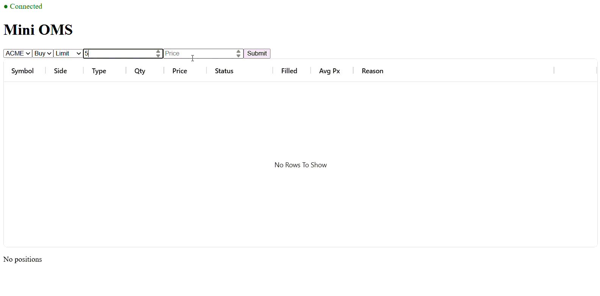

# MiniOMS

This is a small, learning project, which tries to mimic **Order Management System** with a simulated exchange, pre-trade risk checks, live position and P&L tracking, and a real-time web UI. 
Built with .NET 10, Redis, SignalR and React + TypeScript.
There are basic measurement with benchmarks and latency percentiles.



---

## Features

- **Order book matching:** price-time priority, limit and market orders, partial fills. The trade price is the resting order's price.
- **Order lifecycle:** a state machine (`New → Acknowledged → PartiallyFilled → Filled`, or `Cancelled` / `Rejected`). Invalid transitions are logged and ignored, never crashing the loop.
- **Pre-trade risk:** symbol and tick validation, max order quantity (1,000), a ±5% price band and max position per symbol (5,000). Every rejection names the rule.
- **Positions and P&L:** signed positions, a weighted average price, and realized P&L, including position flips.
- **Idempotency:** `ClOrdID` is the idempotency key, so a resent order is rejected, not doubled. Duplicate fills (same `ExecID`) are ignored.
- **Liquidity seeder:** keeps 5 buy and 5 sell levels on each symbol (ACME, BOLT, CRUX), so orders have something to trade against.
- **Live UI:** orders and positions update in real time over SignalR, with a `Pending` / `Unconfirmed` status while waiting for the server.

---

## Architecture

```
 Browser (React + TS)
     │  http://localhost:3000
     ▼
 nginx ── serves the UI, forwards /api and /hubs
     │
     ▼
 WebApi (ASP.NET Core) ── REST: commands + snapshots │ SignalR: live events
     │                                        ▲
     │ minioms:commands                       │ minioms:events
     ▼                                        │
 ┌──────────────────── Redis ─────────────────────┐
 │ pub/sub channels  +  hashes (latest snapshots) │
 └────────────────────────────────────────────────┘
     │                                        ▲
     ▼                                        │
 OmsService ── order lifecycle, risk, positions ──► Exchange (order books, matching)
```

| Flow | Path |
|---|---|
| **Commands** | UI → `POST /api/orders` → WebApi → Redis `minioms:commands` → OmsService |
| **Events** | OmsService → Redis `minioms:events` → WebApi → SignalR → UI |
| **Snapshots** | OmsService saves the latest orders and positions to Redis hashes, and the UI reads them with `GET` on page load and after reconnecting |

---

## Tech stack

| Area | Technology |
|---|---|
| Backend | .NET 10, C#, ASP.NET Core Minimal APIs, SignalR, BackgroundService |
| Messaging and storage | Redis 8 (`StackExchange.Redis`): pub/sub + hashes |
| Frontend | React 19, TypeScript, Vite, `@microsoft/signalr`, AG Grid, pnpm |
| Performance | BenchmarkDotNet, HdrHistogram (custom load generator) |
| Infrastructure | Docker (multi-stage builds), Docker Compose, nginx |

---

## Run it

**Requirements:** Docker Desktop.

```bash
docker compose up --build
```

Open **http://localhost:3000**. That's it.

| Service | Port |
|---|---|
| UI (nginx) | 3000 |
| WebApi | 8080 |
| Redis | 6379 |

Stop it with `docker compose down`.

<details>
<summary>Run locally without Docker (for development)</summary>

1. Start Redis: `docker run -p 6379:6379 redis:8-alpine`
2. Run `MiniOMS.OmsService` and `MiniOMS.WebApi` (WebApi listens on `http://localhost:5244`).
3. Start the UI:
   ```bash
   cd minioms-frontend
   pnpm install
   pnpm dev
   ```
   The Vite dev server forwards `/api` and `/hubs` to `localhost:5244`.
</details>

---

## Performance

Measured on a <your computer specs>, .NET 10. Full details and methods are in [PERFORMANCE.md](PERFORMANCE.md).

| Measurement | Before | After |
|---|---|---|
| Risk check | 45.96 ns, 96 B | **33.82 ns, 0 B** |
| Rest + match (order book) | 497 ns, 1,064 B | **446 ns, 736 B** |
| End-to-end throughput (flood) | 1,338 orders/s | **1,712 orders/s** |
| End-to-end latency at 500 orders/s: p50 | 1.7 ms | **1.2 ms** |
| End-to-end latency at 500 orders/s: p99 | 41 ms | **4.4 ms** |
| End-to-end latency at 500 orders/s: p99.9 | 73 ms | **16 ms** |

**Main improvements:** removing allocations on hot paths (closures, LINQ, boxed enumerators), reusing lists and pooling price levels in the order book, and sending Redis saves and publishes together (`Task.WhenAll`) instead of one by one. The load test uses a fixed send rate to avoid **coordinated omission**.

---

## Design decisions

| Decision | Why |
|---|---|
| **Single writer** in the OMS (one loop reads from a `Channel<T>`) | All order state changes happen on one thread, in order. No locks, and no race conditions |
| **202 Accepted + events** instead of a synchronous reply | REST only means "received". Results arrive as events, which keeps the API fast and the flow the same for every outcome |
| **The client generates `ClOrdID`** | It makes retries safe: a resent order is detected as a duplicate |
| **Save the snapshot, then publish the event** | Pub/sub doesn't replay. Snapshots let a page refresh or reconnect catch up, and `sequence` decides which version is newer |
| **Exchange as a separate library** | Matching knows nothing about Redis or the OMS, so it's easy to test and benchmark on its own |
| **`decimal` for prices** | No floating-point rounding errors on money |
| **nginx in front of the UI** | Serves static files and forwards API and WebSocket traffic, so the frontend uses relative URLs and needs no CORS |

---

## Project structure

```
minioms-backend/
  MiniOMS.Domain        shared types: orders, enums, events, commands
  MiniOMS.Exchange      order books, matching, liquidity seeder
  MiniOMS.Core          OMS engine: lifecycle, risk, positions
  MiniOMS.Messaging     Redis bus and key names
  MiniOMS.OmsService    host: runs Core + Exchange
  MiniOMS.WebApi        REST endpoints + SignalR hub
  MiniOMS.ConsoleClient SignalR test client
  MiniOMS.Benchmarks    BenchmarkDotNet micro-benchmarks
  MiniOMS.LoadGen       end-to-end load generator (HdrHistogram)
  MiniOMS.Tests         unit tests
minioms-frontend/       React + TypeScript UI, nginx config
docker-compose.yml
```

**Docs:** [CONTRACTS.md](CONTRACTS.md) (REST, SignalR and Redis messages) · [PERFORMANCE.md](PERFORMANCE.md) (benchmarks and load tests)

---

## Future improvements

- **Redis Streams** instead of pub/sub, so missed events can be replayed
- **Per-stage timing** to show where end-to-end latency is spent
- **Node pooling** in the order book to cut the remaining allocations
- **TanStack Query** for data fetching and caching in the UI
- Multiple accounts, authentication and a database for order history
- Cloud deployment
